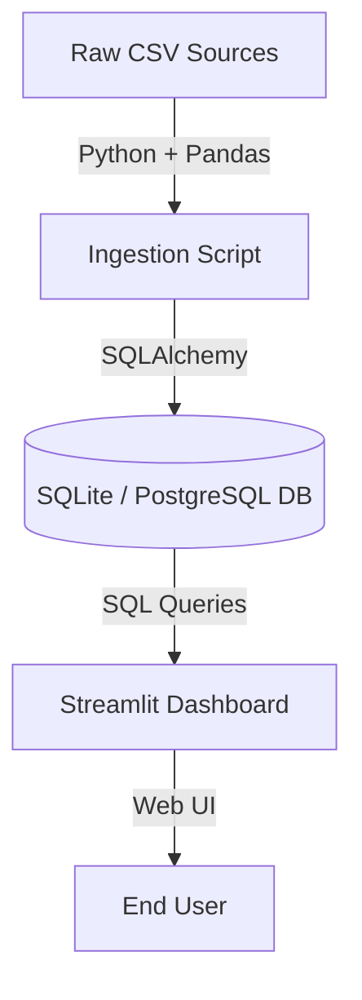

# Design Document: Public-Data Reporting Dashboard

This document details the engineering specifications, relational database model, data cleaning strategy, and implementation architecture for the **Public-Data Reporting Dashboard** (a 6-week project).

---

## 1. Project Overview & Scope

The purpose of this project is to build a reliable, reproducible, and production-ready data reporting pipeline and dashboard. The system will ingest air quality data from the Central Pollution Control Board (CPCB) of India, combine it with city/state census metadata, clean anomalies, and present analytical insights to decision-makers.

### Project Durations & Milestones
- **Week 1**: Pick datasets, explore raw data quality, and compile the design document.
- **Week 2**: Build relational schema and repeatable ingestion pipeline.
- **Week 3**: Implement data cleaning logic, flag anomalies, and output the data-quality report.
- **Week 4**: Implement first two analytical queries (Seasonal Swing & Population-Weighted AQI).
- **Week 5**: Implement last two analytical queries (Threshold Compliance & Data Reliability) and wire up the Streamlit dashboard.
- **Week 6**: Deploy publicly, polish performance, and write final documentation.

---

## 2. Dataset Analysis & Data Messiness

Our research and exploration of the raw files (`cities_population.csv`, `city_day.csv`, `station_day.csv`, and `stations.csv`) revealed several data quality issues that must be addressed programmatically:

### 2.1 Missing Values
The air quality datasets contain a high percentage of missing values:
- **PM2.5**: ~15.5% missing in city data; ~20.0% in station data.
- **PM10**: ~37.7% missing in city data; ~39.5% in station data.
- **Xylene**: ~61.3% missing in city data; ~78.8% in station data.
- **AQI**: ~15.8% missing in city data; ~19.4% in station data.

*Cleaning Action*: We preserve missing pollutant values as `NULL` in the database rather than dropping rows. Deleting rows would destroy historical timelines. Linear interpolation is applied for short gaps (1 or 2 consecutive missing days) grouped by city/station, while long gaps remain as `NULL` to preserve analytical accuracy.

### 2.2 Schema & City Name Mismatches
The city names in `cities_population.csv` contain trailing whitespaces (e.g., `"Ahmadabad "` instead of `"Ahmadabad"`). Additionally, spelling differences exist between the datasets:
- `Ahmedabad` (Air Quality) vs. `Ahmadabad` (Population)
- `Amaravati` (Air Quality) vs. `Amravati` (Population)
- `Gurugram` (Air Quality) vs. `Gurgaon` (Population)
- `Hyderabad` (Air Quality) vs. `Greater Hyderabad` (Population)
- `Mumbai` (Air Quality) vs. `Greater Mumbai` (Population)
- `Kochi` vs. `Kochi` (matching Kochi), but `Ernakulam` (district of Kochi) has no direct match.

*Cleaning Action*: The ingestion script trims all whitespaces from string columns and maps names using an explicit translation dictionary. `Ernakulam` is mapped to the Kochi population.

### 2.3 Small Towns Missing from Census
Several towns present in the air quality/stations dataset (e.g., `Brajrajnagar`, `Jorapokhar`, `Talcher`) are small industrial towns and are missing from the census dataset (which covers cities with populations > 100,000).

*Cleaning Action*: We manually inject estimated populations for these towns during the ingestion stage:
- **Brajrajnagar**: 80,000
- **Jorapokhar**: 85,000
- **Talcher**: 40,000

### 2.4 Anomaly Patterns
- **Physically Impossible Values**: CPCB AQI has a standard scale of 0 to 500. However, the raw data contains values exceeding 500, with a maximum value of **2049.0** (e.g., Ahmedabad on 2016-07-14 reported AQI 1842.0 while PM2.5 was only 38.13).
- **Stuck Sensors**: PM2.5 or AQI flatlining (having the exact same decimal value) for 3+ consecutive days.
- **Sensor Saturation**: PM2.5 or PM10 values flatlining at exactly 1000.0 (sensor capping).
- **Negative Values**: Physically impossible negative concentrations.

*Cleaning Action*: Rather than silently deleting these rows, we insert them into the database but set a boolean flag `is_reliable = FALSE` on the record. This allows the dashboard to display anomalies transparently and let the user filter them out.

---

## 3. Relational Schema Design

To ensure database consistency, prevent update anomalies, and eliminate data redundancy, the database is normalized to Boyce-Codd Normal Form (BCNF) and 3rd Normal Form (3NF). We use a **Class Table Inheritance (Supertype/Subtype)** pattern to merge city and station readings into a unified fact table while preserving foreign key constraints, and model population temporally. All tables are joined on integer ID columns.

```mermaid
erDiagram
    dim_states {
        int state_code PK
        varchar state_name UNIQUE
    }
    dim_locations {
        int location_id PK
        int parent_id FK "Points to parent city location_id for stations"
        varchar type "'city' or 'station'"
    }
    dim_cities {
        int city_record_id PK
        varchar city_name
        int state_code FK
        int population
        float literacy_rate
        int sex_ratio
        date start_date
        date end_date
    }
    dim_city_anomalies {
        varchar raw_city_name PK "Raw/Variation City Name (e.g. Ahmadabad, Gurgaon)"
        int city_record_id FK "FK to dim_cities.city_record_id"
    }
    dim_stations {
        varchar station_id PK "Station identifier string (e.g. AP001)"
        int city_record_id FK "FK to dim_cities.city_record_id"
        varchar station_name
        varchar status
    }
    dim_agency_registry {
        int agent_id PK
        varchar agent_name UK
        varchar supported_schema "SchemaA or SchemaB"
        varchar drop_location "Folder path for inbound files"
        boolean is_active
    }
    fact_ingestion_logs {
        int log_id PK
        varchar agent_name
        varchar schema_used
        varchar file_name
        varchar drop_location
        varchar archive_location
        int total_rows
        int processed_rows
        int rejected_rows
        varchar status
        timestamp timestamp
        text error_details
    }
    fact_readings {
        int reading_id PK
        int location_id FK
        date date
        float pm25
        float pm10
        float no2
        float co
        float so2
        float o3
        float aqi
        boolean is_reliable
    }

    dim_states ||--o{ dim_cities : "contains"
    dim_cities ||--o{ dim_city_anomalies : "has aliases/anomalies"
    dim_cities ||--o{ dim_stations : "has stations"
    dim_locations ||--o| dim_locations : "parent-child (city -> station)"
    dim_locations ||--o{ fact_readings : "records"
    dim_agency_registry ||--o{ fact_ingestion_logs : "tracks execution"
```

### 3.1 Normalization Explanations
1. **dim_states**: Separated from `dim_cities` to remove the transitive dependency `city_name -> state_code -> state_name` (**3NF**).
2. **dim_locations**: A unified locations supertype registry utilizing auto-incrementing integer key `location_id` and self-referential `parent_id` (linking stations to their parent city location).
3. **dim_cities**: Uses `city_name`, `state_code`, and incorporates `start_date` and `end_date` to manage inconstant population over time natively (Slowly Changing Dimension Type 2).
4. **dim_city_anomalies**: Maps raw city name variations/misspellings (`raw_city_name` PK) to their normalized `city_record_id` (**BCNF**).
5. **dim_stations**: Keyed by `station_id` (station code e.g. `'AP001'`), containing `city_record_id` (FK to `dim_cities`), `station_name`, and `status`.
6. **dim_agency_registry**: Setup registry table mapping agents to their assigned schema (`SchemaA`/`SchemaB`) and folder drop location (**BCNF**).
7. **fact_ingestion_logs**: Audit log table recording post-processing ingestion metrics, archiving destinations, and row rejection reasons.
8. **fact_readings**: Merges city and station daily readings, using integer `location_id` (FK to `dim_locations.location_id`) to enforce strict referential BCNF integrity.

### 3.2 Database Indexes
- `idx_readings_loc_date`: On `fact_readings(location_id, date)` (speeds up time-series filtering, audits, and joins).

---

## 4. Technical Architecture & Technology Stack



### 4.1 Storage (Database Agility)
We choose to build our ingestion pipeline using **SQLAlchemy ORM** to ensure database agility.
- **Development**: Local **SQLite** database (`air_quality.db`), which requires zero configuration and provides a fully offline, reproducible sandbox.
- **Production**: **PostgreSQL** hosted on **Supabase** or **Neon**. The connection string can be swapped transparently via the environment variable `DATABASE_URL`.

### 4.2 Ingestion Pipeline
Written in Python:
1. Load raw CSVs.
2. Normalize column names (e.g., convert `PM2.5` to `pm25`).
3. Strip trailing spaces from all strings.
4. Apply spelling conversions to standardise city and state names.
5. Ingest `dim_states`.
6. Ingest unique cities and stations into `dim_locations`.
7. Ingest `dim_cities` with population bounds, and `dim_stations` with parent city names.
8. Audit readings for stuck sensors, negative concentrations, and out-of-scale AQIs, setting `is_reliable = FALSE` on flagged rows.
9. Apply linear interpolation on valid days for short gaps (<= 2 days).
10. Bulk load city and station data into unified `fact_readings`.

---

## 5. Analytical Queries Formulation (Redesigned Schema)

We will write clean, raw SQL queries to implement the analytical dashboard views.

### 5.1 Seasonal Swing
*Requirement*: Find the worst 5 cities comparing Winter (Nov-Feb) vs. Summer (Apr-Jun) and calculate the seasonal swing.
```sql
WITH CitySeasons AS (
    SELECT 
        l.location_name AS city_name,
        AVG(CASE WHEN strftime('%m', r.date) IN ('11', '12', '01', '02') THEN r.pm25 END) AS winter_avg,
        AVG(CASE WHEN strftime('%m', r.date) IN ('04', '05', '06') THEN r.pm25 END) AS summer_avg
    FROM fact_readings r
    JOIN dim_locations l ON r.location_id = l.location_id
    JOIN dim_cities c ON l.location_id = c.location_id
    WHERE r.is_reliable = 1 AND l.type = 'city' AND r.pm25 IS NOT NULL
      AND r.date BETWEEN c.start_date AND COALESCE(c.end_date, '9999-12-31')
    GROUP BY l.location_id
)
SELECT 
    city_name,
    winter_avg,
    summer_avg,
    (winter_avg - summer_avg) AS seasonal_swing
FROM CitySeasons
WHERE winter_avg IS NOT NULL AND summer_avg IS NOT NULL
ORDER BY seasonal_swing DESC
LIMIT 5;
```

### 5.2 Population-Weighted State AQI
*Requirement*: Rank states by population-weighted average AQI for the most recent complete month.
```sql
WITH LatestMonth AS (
    SELECT strftime('%Y-%m', MAX(date)) AS ym FROM fact_readings
),
MonthlyCityAQI AS (
    SELECT 
        c.state_code,
        l.location_name AS city_name,
        c.population,
        AVG(r.aqi) AS avg_city_aqi
    FROM fact_readings r
    JOIN dim_locations l ON r.location_id = l.location_id
    JOIN dim_cities c ON l.location_id = c.location_id
    WHERE r.is_reliable = 1 AND l.type = 'city' AND r.aqi IS NOT NULL
      AND strftime('%Y-%m', r.date) = (SELECT ym FROM LatestMonth)
      AND r.date BETWEEN c.start_date AND COALESCE(c.end_date, '9999-12-31')
    GROUP BY c.state_code, l.location_id, c.population
)
SELECT 
    s.state_name,
    SUM(m.avg_city_aqi * m.population) / SUM(m.population) AS weighted_aqi
FROM MonthlyCityAQI m
JOIN dim_states s ON m.state_code = s.state_code
GROUP BY s.state_code
ORDER BY weighted_aqi DESC, s.state_name ASC;
```

### 5.3 Threshold Compliance & Trend
*Requirement*: For each major city, check the % of days exceeding the national PM2.5 threshold (60 µg/m³) and indicate if it is improving or worsening year-over-year.
```sql
WITH CityYearlyCompliance AS (
    SELECT 
        l.location_name AS city_name,
        strftime('%Y', r.date) AS year,
        COUNT(CASE WHEN r.pm25 > 60 THEN 1 END) * 100.0 / COUNT(r.pm25) AS exceedance_rate
    FROM fact_readings r
    JOIN dim_locations l ON r.location_id = l.location_id
    JOIN dim_cities c ON l.location_id = c.location_id
    WHERE r.is_reliable = 1 AND l.type = 'city' AND r.pm25 IS NOT NULL
      AND r.date BETWEEN c.start_date AND COALESCE(c.end_date, '9999-12-31')
    GROUP BY l.location_id, year
),
YearOverYear AS (
    SELECT 
        y1.city_name,
        y1.year AS current_year,
        y1.exceedance_rate AS current_rate,
        y2.year AS prev_year,
        y2.exceedance_rate AS prev_rate
    FROM CityYearlyCompliance y1
    LEFT JOIN CityYearlyCompliance y2 
        ON y1.city_name = y2.city_name AND CAST(y1.year AS INTEGER) = CAST(y2.year AS INTEGER) + 1
)
SELECT 
    y.city_name,
    y.current_year,
    y.current_rate,
    y.prev_rate,
    CASE 
        WHEN y.prev_rate IS NULL THEN 'No Baseline'
        WHEN y.current_rate < y.prev_rate THEN 'Improving'
        ELSE 'Worsening'
    END AS trend
FROM YearOverYear y
ORDER BY y.city_name, y.current_year;
```

### 5.4 Data Reliability Audit
*Requirement*: Identify monitoring stations with long gaps, stuck sensors, or impossible readings, and show the percentage of affected data.
```sql
SELECT 
    s.station_code AS station_id,
    l.location_name AS station_name,
    lc.location_name AS city_name,
    COUNT(CASE WHEN r.is_reliable = 0 THEN 1 END) AS unreliable_count,
    COUNT(r.reading_id) AS total_readings,
    (COUNT(CASE WHEN r.is_reliable = 0 THEN 1 END) * 100.0 / COUNT(r.reading_id)) AS unreliable_percentage
FROM fact_readings r
JOIN dim_locations l ON r.location_id = l.location_id
JOIN dim_stations s ON l.location_id = s.location_id
JOIN dim_locations lc ON s.parent_location_id = lc.location_id
WHERE l.type = 'station'
GROUP BY s.station_code
ORDER BY unreliable_percentage DESC;
```

---

## 6. Verification Plan

We will verify the implementation of our database schema and analytical queries by:
1. **Source Row Counts**: Comparing the total rows in the database against the source CSV files.
2. **Aggregations Double-Check**: Comparing SQL averages against direct Pandas calculations.
3. **Foreign Key Integrity**: Running queries to check for any orphan records in the fact tables.
